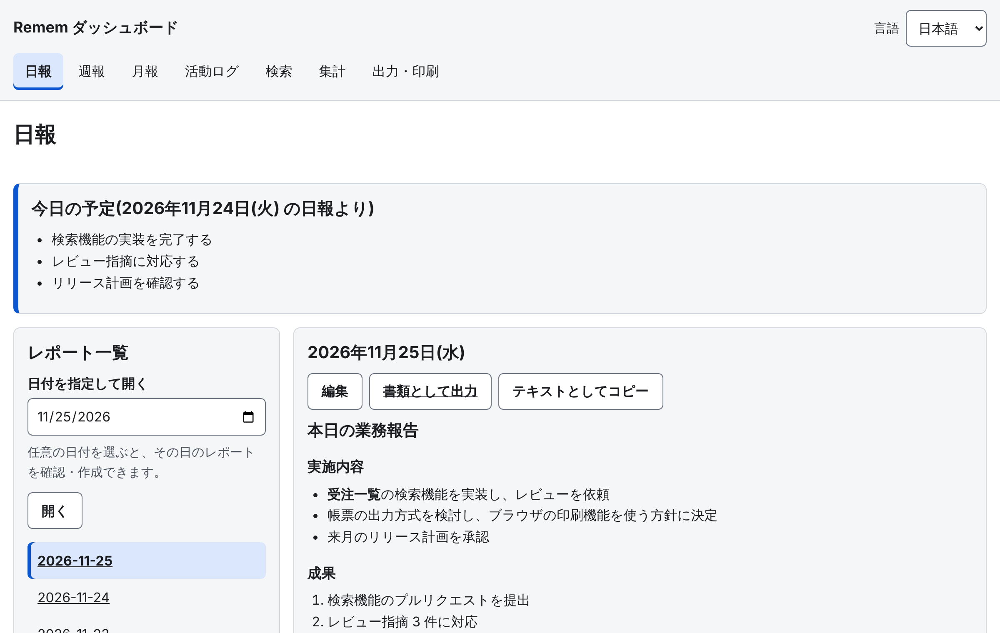
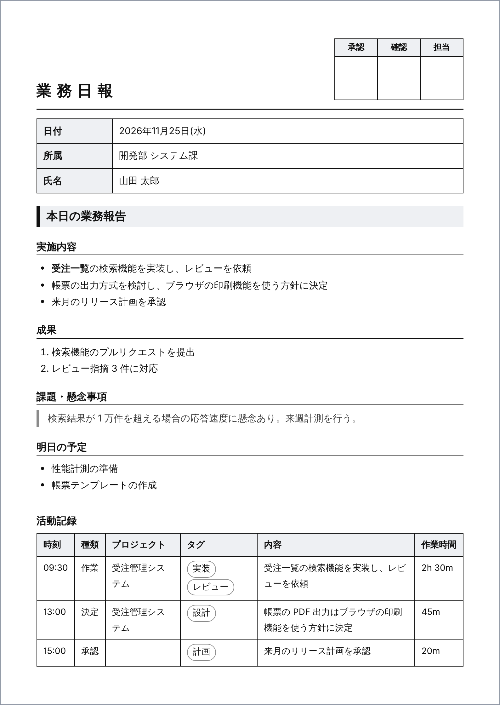
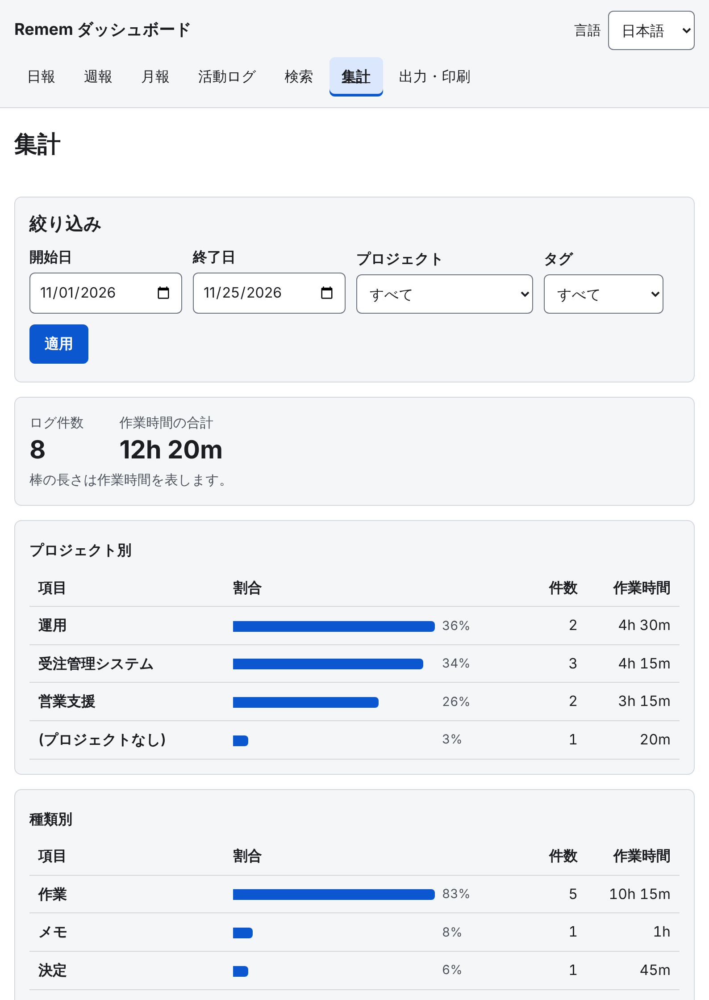

<div align="center">


# Remem

**記録する。日報を作る。いつでも振り返る。**

[](https://www.npmjs.com/package/@remem/mcp-server)
[](https://opensource.org/licenses/MIT)
[](https://nodejs.org/)

[English](https://github.com/remem-mcp/mcp-server/blob/main/README.md)

</div>

---

## 概要

**Remem** は、日々の活動を記録し、日報を自動生成し、長期間の振り返りを可能にするローカルファーストのMCP（Model Context Protocol）サーバーです。**人のための業務記録**として、日報・週報・月報、工数の記録、そのまま提出できる書類の作成に対応します。

- 📝 **記録** — 一日を通して作業、決定、メモを残す
- 🏷️ **分類** — プロジェクトやタグでログを整理し、作業時間も記録
- 📊 **レポート生成** — 活動ログから日報・週報・月報を作成
- 📌 **続きから始める** — 前日に立てた予定を、その日最初に Remem を使ったときに表示
- 🔍 **探す** — ログやレポートを検索し、時間の使い方を集計
- 🖥️ **閲覧** — ブラウザのダッシュボードでレポートを確認・編集・印刷
- 🔒 **ローカルで安全に** — すべて手元の SQLite に保存し、パスワードや鍵は自動でマスク

<p align="center">
  
</p>

**目次**

- [クイックスタート](#クイックスタート)
- [仕組み](#仕組み)
- [機能](#機能)
- [ツール](#ツール)
- [Webダッシュボード](#webダッシュボード)
- [コマンドライン](#コマンドライン)
- [設定](#設定)
- [開発](#開発)
- [ロードマップ](#ロードマップ)
- [コントリビュート](#コントリビュート)
- [ライセンス](#ライセンス)

---

## クイックスタート

Remem は MCP に対応したクライアントであれば利用できます。Node.js 22 以降が必要です。

設定例では `@remem/mcp-server@latest` を指定しています。クライアントの起動時に、毎回最新版が使われます。`@latest` を付けない場合、`npx` が以前ダウンロードした古い版を使い続けることがあります。特定の版に固定したい場合は、`@remem/mcp-server@2.0.0` のようにバージョンを指定してください。

### 1コマンドで設定

```bash
npx -y @remem/mcp-server@latest setup
```

Claude Code、Claude Desktop、Codex のうち、インストールされているものに Remem を登録します。既存の `remem` の設定は上書きせず、ほかの設定もそのまま残し、ファイルを変更する前にバックアップを保存します。`--dry-run` で変更内容の確認だけを行い、`--client claude-code`（または `claude-desktop`、`codex`）で対象を1つに絞れます。設定後はクライアントを再起動してください。

`--hooks` を付けると、Claude Code のフックも2つ設定します。セッション開始時に今日の予定を表示し、終了時にコミットを記録します。

以下は、同じ設定を手動で行う場合の手順です。

### Claude Code

```bash
claude mcp add remem -- npx -y @remem/mcp-server@latest
```

### Claude Desktop

Claude Desktop の設定ファイルに Remem を追加します。

```json
{
  "mcpServers": {
    "remem": {
      "command": "npx",
      "args": ["-y", "@remem/mcp-server@latest"]
    }
  }
}
```

<details>
<summary>📁 設定ファイルの場所</summary>

| OS | パス |
|----|------|
| macOS | `~/Library/Application Support/Claude/claude_desktop_config.json` |
| Windows | `%APPDATA%\Claude\claude_desktop_config.json` |

</details>

### Codex

```bash
codex mcp add remem -- npx -y @remem/mcp-server@latest
```

または `~/.codex/config.toml` に追加します。

```toml
[mcp_servers.remem]
command = "npx"
args = ["-y", "@remem/mcp-server@latest"]
```

### opencode

`opencode.json` の `mcp` セクションに Remem を追加します。

```json
{
  "$schema": "https://opencode.ai/config.json",
  "mcp": {
    "remem": {
      "type": "local",
      "command": ["npx", "-y", "@remem/mcp-server@latest"],
      "enabled": true
    }
  }
}
```

`mcp` セクションの書き方は opencode のバージョンによって異なります（新しいバージョンでは `mcp.servers` の下に記述します）。お使いのバージョンに合わせて [opencode の MCP ドキュメント](https://opencode.ai/docs/mcp-servers) をご確認ください。このため、`remem setup` は opencode の設定を行いません。

### Muse Code などその他のクライアント

お使いのクライアントの MCP 設定に、ローカル（stdio）の MCP サーバーとして次の内容を登録してください。

- **コマンド:** `npx`
- **引数:** `-y`、`@remem/mcp-server@latest`

MCP サーバーの設定場所は、各クライアントのドキュメントをご確認ください。

> Remem はお使いのコンピューター上で動作し、データもそこに保存します。リモート（インターネット上）の MCP サーバーにしか接続できないクラウド型のアシスタントからは、直接利用できません。

### 使い方

Remem は接続時に使い方をアシスタントへ伝えるため、次のように話しかけるだけで使えます。

- 「ログイン画面のレビューが終わったことを記録して」
- 「今日の日報を書いて」
- 「今週の週報を書いて」「先月の月報を書いて」
- 「先月は何に取り組んでいた？」
- 「Remem のダッシュボードを開いて」

MCP のプロンプトに対応したクライアントでは、`daily_report`、`weekly_report`、`monthly_report`、`log_session` が定型コマンドとして表示されます。

<details>
<summary>💡 コーディングエージェントに自動で記録させる</summary>

プロジェクトの指示ファイルに書いておくと、エージェントがより確実に記録します。`AGENTS.md`（Codex、opencode など）または `CLAUDE.md`（Claude Code）に次の内容を追加してください。

```markdown
## 作業ログ

タスクを完了したとき、または設計上の決定をしたときは、Remem の `log` ツールで記録すること。
`project` にはこのリポジトリ名を指定し、タグは `list_tags` で確認した既存のものを再利用すること。
```

</details>

---

## 仕組み

Remem を使った一日の流れです。

1. **朝** — アシスタントがその日最初に Remem を使ったとき、前日に立てた予定を表示します。
2. **日中** — 作業・決定・承認を、プロジェクト、タグ、作業時間とともにその都度記録します: `log(work, "PR #123 をレビュー", minutes: 45)`。コミットは自動で取り込むこともできます。
3. **夕方** — 日報の作成を依頼します。アシスタントが `prepare_report` でその日のログを集め、テンプレートに沿って日報を書き、`save_summary` で翌日の予定とともに保存します。
4. **週末・月末** — `prepare_period_report` が日報をまとめ、プロジェクト別の作業時間つきで週報・月報を作成します。
5. **数ヶ月後** — 「前の四半期は何をしていた？」という問いに、`search`、`get_history`、`get_stats` で答えます。

すべてのデータは、1つの SQLite ファイル `~/.remem/remem.db` に保存されます。

| データ | 保存期間 |
|--------|----------|
| 活動ログ | `retention_days`（デフォルト: 30日） |
| 日報・週報・月報 | 無期限 |

---

## 機能

| 機能 | 説明 |
|------|------|
| **アクティビティ記録** | 作業、決定、メモ、承認をリアルタイムで記録。後から修正・削除も可能 |
| **プロジェクト・タグ・作業時間** | ログをプロジェクトとタグで分類し、作業時間を記録 |
| **スマート日報** | カスタマイズ可能なテンプレートで日報を生成 |
| **週報・月報** | 日報をまとめて週単位・月単位のレポートを作成（プロジェクト別の時間つき） |
| **今日の予定** | 前回の日報で立てた予定を、翌日最初の利用時に表示 |
| **検索・集計** | キーワードで検索。プロジェクト・種類・タグ・日別に件数と時間を集計 |
| **Git の取り込み** | コミットをログとして記録し、記録漏れを防止 |
| **Webダッシュボード** | ブラウザでレポートを確認・検索・編集・出力・印刷 |
| **エクスポート・共有** | Markdown / テキスト / JSON ファイル。ダッシュボードから業務文書として印刷・PDF保存 |
| **機密情報のマスク** | パスワード・トークン・鍵と思われる値は保存前に置き換え |
| **バックアップ・復元** | 1つのファイルで別のコンピューターへ移行 |
| **長期記憶** | 要約は永続保存され、将来の振り返りが可能 |
| **自動クリーンアップ** | 詳細ログは設定日数後に自動削除（デフォルト: 30日） |
| **多言語対応** | システム言語に自動適応（日本語/英語） |
| **プライバシー優先** | すべてのデータは `~/.remem/remem.db` にローカル保存 |

---

## ツール

Rememは以下のMCPツールを提供します。データを返すツールは、対応クライアント向けに構造化された形式でも結果を返します。

**記録**

| ツール | 内容 |
|--------|------|
| `log` | アクティビティ（`work`、`decision`、`memo`、`approval`）を記録。`project`、`tags`、`minutes`（作業時間）、後から記録するための `date` / `time` を指定可能 |
| `update_log` | 既存のログを修正 |
| `delete_log` | ログを削除 |
| `import_git_commits` | ローカルの Git リポジトリのコミットをログとして記録（各コミット1回のみ） |
| `list_tags` | 使用中のプロジェクトとタグを一覧表示 |

**レポート**

| ツール | 内容 |
|--------|------|
| `prepare_report` | その日のログ、作業時間、前回の予定、テンプレートを収集し、AIが日報を書くためのデータを準備 |
| `save_summary` | 日報を保存。次回の予定（`next_plan`）も保存可能 |
| `prepare_period_report` | 週または月の日報を収集し、AIが週報・月報を書くためのデータを準備 |
| `save_period_summary` | 週報・月報を保存 |
| `get_briefing` | 直近の日報で立てた予定を表示 |

**振り返り**

| ツール | 内容 |
|--------|------|
| `search` | ログとレポートをキーワードで検索し、関連度の高い順に表示。すべての語を含むものがなければ、一部を含むものを表示 |
| `get_history` | 過去の日報・週報・月報を取得 |
| `get_report` | レポートを1件取得。Markdown、またはチャットやメールに貼りやすいテキスト形式 |
| `get_stats` | プロジェクト・種類・タグ・日別に件数と作業時間を集計 |

**その他**

| ツール | 内容 |
|--------|------|
| `export` | レポートを Markdown / テキスト / JSON ファイルとして `~/.remem/exports/` に出力 |
| `open_dashboard` | Webダッシュボードを起動し、アドレスを返す |
| `configure` / `get_config` | 設定の変更・表示 |

### 今日の予定

日報を保存するとき、次にやる予定も一緒に保存されます。翌日以降に Remem のツールが最初に使われたとき、その予定が結果に添えられるため、アシスタントが何も聞かれなくても「前回の続き」を伝えられます。ダッシュボードの上部にも表示されます。予定が保存されていない日報の場合は、本文の「明日の予定」「Next steps」などの見出しの内容を使います。

### 機密情報のマスク

AIアシスタントは、コマンドや設定の断片をそのままログに書いてしまうことがあります。Remem は保存前に、認証情報と思われる値（APIキー、トークン、`password=...`、秘密鍵、URL内のパスワード）を `[REDACTED]` に置き換え、その旨をアシスタントに伝えます。これは既知のパターンに基づく安全策であり、完全ではありません。そもそもログに機密情報を書かないようにしてください。

---

## Webダッシュボード

ブラウザでレポートを確認・編集できます。AIアシスタントに「Rememのダッシュボードを開いて」と依頼するか、次のコマンドで起動します。

```bash
npx -y @remem/mcp-server@latest ui            # http://localhost:3939/
npx -y @remem/mcp-server@latest ui --port 8080
```

- **日報・週報・月報** — レポートの閲覧、作成、編集（Markdown）、次回の予定の入力、テキストとしてコピー
- **活動ログ** — 期間、プロジェクト、タグで絞り込み。ログの編集・削除
- **検索** — ログとレポートをキーワードで検索
- **集計** — プロジェクト・種類・タグ・日別の件数と作業時間
- **出力・印刷** — Markdown / テキスト / JSON のダウンロード、または書類としてプレビューし、ブラウザの印刷ダイアログから印刷・PDF保存

<p align="center">
  
  
</p>

**業務文書として印刷。** レポートを A4 の業務日報（週報・月報）として印刷できます。スタイル（「ビジネス文書」「標準」「コンパクト」）と書体（ゴシック体・明朝体）を選び、氏名と所属を入れ、承認欄・絵文字の省略・改ページ・活動ログの有無を切り替えられます。これらの設定はブラウザに保存されます。

**表示言語。** ダッシュボードはブラウザの言語（日本語・英語）に合わせて表示され、画面上部で切り替えることもできます。日付も選んだ言語の形式で表示されます。

ダッシュボードはお使いのコンピューター上（`127.0.0.1`）でのみ待ち受け、他のサイトからのリクエストは拒否します。WCAG 2.1 AA に準拠するよう作られています（キーボードのみでの操作、スクリーンリーダー向けのラベル、ライト/ダーク両テーマでの十分なコントラスト、幅320pxまでのリフロー）。

---

## コマンドライン

`remem` コマンドは、AIアシスタントなしでも使えます。スクリプトやフックからの利用に便利です。`npx -y @remem/mcp-server@latest <コマンド>` で実行します。

| コマンド | 内容 |
|----------|------|
| `remem setup [--hooks] [--dry-run] [--client NAME]` | このコンピューターの MCP クライアントに Remem を登録 |
| `remem ui [--port N]` | Webダッシュボードを起動 |
| `remem briefing [--always]` | 今日の予定を表示（1日1回） |
| `remem log <種類> <内容> [--project P] [--tags a,b] [--minutes N] [--date D]` | アクティビティを記録 |
| `remem import-commits [--repo PATH] [--since DATE] [--project P] [--all-authors]` | Git のコミットをログとして記録 |
| `remem backup [FILE]` | すべてのデータを JSON でバックアップ |
| `remem restore FILE [--overwrite]` | バックアップをデータベースに取り込む |

### コミットを自動で記録する

リポジトリに次の Git フックを置くと、コミットするたびに記録されます（`.git/hooks/post-commit` に保存し、実行権限を付与）。

```sh
#!/bin/sh
npx -y @remem/mcp-server@latest import-commits --repo "$(git rev-parse --show-toplevel)" >/dev/null 2>&1 &
```

各コミットは1回しか取り込まれないため、繰り返し実行しても問題ありません。

### バックアップ

`remem backup` は、ログ・レポート・設定のすべてを1つの JSON ファイルに書き出します。`remem restore` はそのファイルをデータベースに取り込みます。既存のレポートや同一のログはそのまま残すため、2回復元しても重複しません。バックアップファイルにはレポートが平文で含まれるため、人目に触れない場所に保管してください。

---

## 設定

| キー | デフォルト | 説明 |
|------|-----------|------|
| `retention_days` | `30` | 詳細なアクティビティログの保持日数（1〜365） |
| `default_template` | （組み込み） | 日報のMarkdownテンプレート |
| `weekly_template` | （組み込み） | 週報のMarkdownテンプレート |
| `monthly_template` | （組み込み） | 月報のMarkdownテンプレート |
| `week_start` | `monday` | 週報の週の開始曜日（`monday` または `sunday`） |

`configure` ツールで設定できます。

| 環境変数 | デフォルト | 説明 |
|----------|-----------|------|
| `REMEM_DATA_DIR` | `~/.remem` | データベースとエクスポートの保存先 |
| `REMEM_LANG` | システムの言語 | `en` または `ja` |
| `REMEM_UI_PORT` | `3939` | Webダッシュボードのポート番号 |

> **ログの保持について:** `retention_days` を過ぎた活動ログは、`prepare_report` の実行時に削除されます。保存済みの日報・週報・月報は削除されません。残しておきたい日は要約を保存してください。

---

## 開発

```bash
# リポジトリをクローン
git clone https://github.com/remem-mcp/mcp-server.git
cd mcp-server

# 依存関係をインストール
npm install

# ビルド
npm run build

# テスト実行
npm test

# MCPサーバーをローカルで実行
node build/index.js

# Webダッシュボードをローカルで実行
node build/index.js ui
```

### リリース手順

1. `package.json`（および `package-lock.json`）と `server.json` の `version` を更新し、変更内容を `CHANGELOG.md` に追記します。
2. GitHub で `vX.Y.Z` という名前のリリースを公開します。

リリース用のワークフローが、パッケージを npm に公開し、同じバージョンを [MCP Registry](https://registry.modelcontextprotocol.io/) に登録します。登録の処理だけをやり直す場合は、Actions タブから「Publish」ワークフローを手動で実行してください。

### 技術スタック

- **ランタイム**: Node.js 22+
- **言語**: TypeScript
- **データベース**: SQLite（Kysely + better-sqlite3）
- **プロトコル**: MCP SDK
- **国際化**: i18next
- **テスト**: Vitest

---

## ロードマップ

- [x] 履歴閲覧用のWeb UI
- [x] Markdown/PDFエクスポート
- [x] 週報・月報
- [x] プロジェクト・タグ
- [x] 検索・集計・作業時間の記録
- [x] 今日の予定の表示
- [ ] クラウドストレージ経由のチーム同期
- [ ] 多言語対応の拡充（中国語、韓国語、スペイン語など）
- [ ] VS Code拡張機能との統合

リリースノートは [CHANGELOG.md](https://github.com/remem-mcp/mcp-server/blob/main/CHANGELOG.md) をご覧ください。

---

## コントリビュート

コントリビュートは大歓迎です！お気軽にPull Requestを送ってください。

1. リポジトリをフォーク
2. フィーチャーブランチを作成（`git checkout -b feature/amazing-feature`）
3. [Conventional Commits](https://www.conventionalcommits.org/ja/) 形式でコミット
4. ブランチにプッシュ（`git push origin feature/amazing-feature`）
5. Pull Requestを作成

### コミットメッセージの形式

このプロジェクトでは [Conventional Commits](https://www.conventionalcommits.org/ja/) を採用しています。

```
<type>: <description>

[任意の本文]
```

**Type:** `feat`, `fix`, `docs`, `style`, `refactor`, `test`, `chore`

**例:**
```
feat: add weekly summary generation
fix: correct date parsing in prepare_report
docs: update installation instructions
```

---

## ライセンス

MIT © [Remem Contributors](https://github.com/remem-mcp)

---

<div align="center">

**[⬆ トップに戻る](#remem)**

</div>
