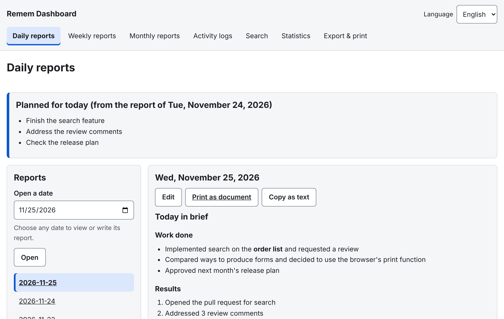
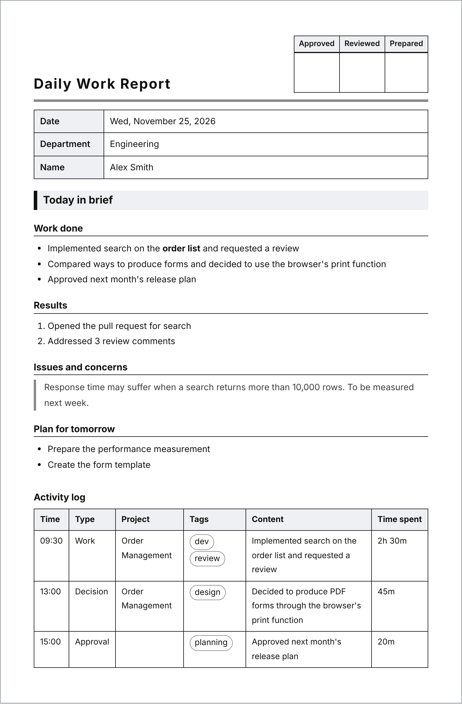
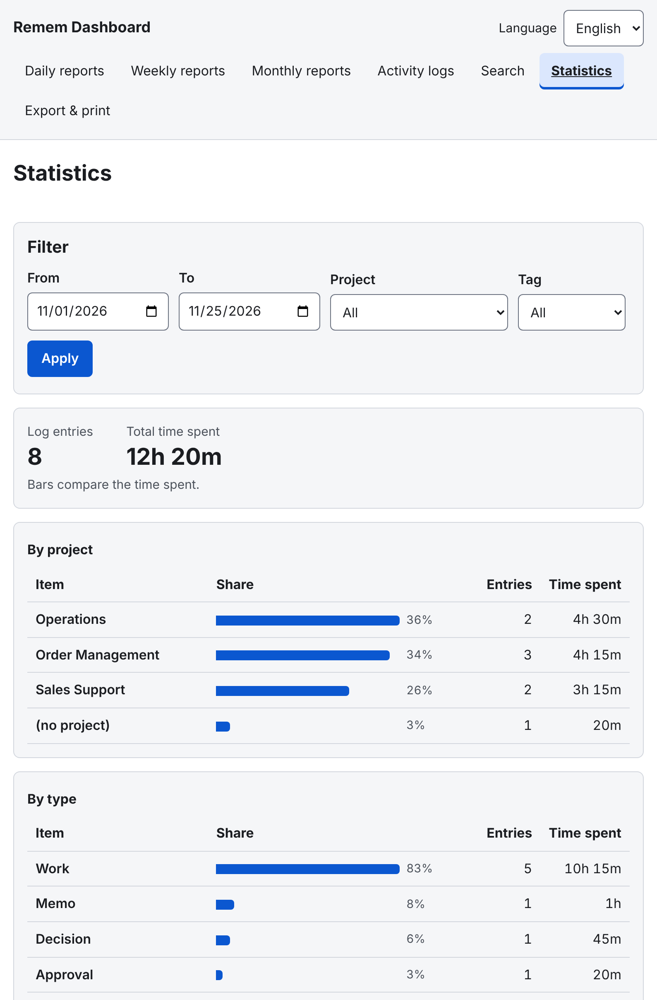

<div align="center">


# Remem

**Log your day. Generate reports. Reflect anytime.**

[](https://www.npmjs.com/package/@remem/mcp-server)
[](https://opensource.org/licenses/MIT)
[](https://nodejs.org/)

[日本語](https://github.com/remem-mcp/mcp-server/blob/main/README.ja.md)

</div>

---

## Overview

**Remem** is a local-first MCP (Model Context Protocol) server that captures your daily activities, generates structured reports, and preserves summaries for long-term reflection. It is a **work journal for people**: daily, weekly and monthly work reports, time tracking, and documents you can hand in.

- 📝 **Log** — Record your work, decisions, and memos throughout the day
- 🏷️ **Organize** — Classify logs by project and tags, and track time spent
- 📊 **Generate** — Create daily, weekly and monthly reports from your logs
- 📌 **Pick up where you left off** — Yesterday's plan is shown the first time you use Remem each day
- 🔍 **Find** — Search logs and reports, and see where your time went
- 🖥️ **Browse** — View, edit and print reports in a local web dashboard
- 🔒 **Local and safe** — Everything stays in SQLite on your computer; passwords and keys are masked

<p align="center">
  
</p>

**Contents**

- [Quick Start](#quick-start)
- [How It Works](#how-it-works)
- [Features](#features)
- [Tools](#tools)
- [Web Dashboard](#web-dashboard)
- [Command Line](#command-line)
- [Configuration](#configuration)
- [Development](#development)
- [Roadmap](#roadmap)
- [Contributing](#contributing)
- [License](#license)

---

## Quick Start

Remem works with any MCP client. It needs Node.js 22 or later.

The examples use `@remem/mcp-server@latest`, so the newest version is used each time the client starts. Without `@latest`, `npx` can keep running an older copy it has already downloaded. To stay on one version, write it out instead, for example `@remem/mcp-server@2.0.0`.

### One command

```bash
npx -y @remem/mcp-server@latest setup
```

This registers Remem with Claude Code, Claude Desktop and Codex, whichever are installed. It never replaces an existing `remem` entry, keeps your other settings, and saves a backup before changing a file. Use `--dry-run` to see what it would do, and `--client claude-code` (or `claude-desktop`, `codex`) to pick one. Restart the client afterwards.

Add `--hooks` to also install two Claude Code hooks: the daily briefing is shown when a session starts, and your commits are recorded when it ends.

The sections below describe the same setup by hand.

### Claude Code

```bash
claude mcp add remem -- npx -y @remem/mcp-server@latest
```

### Claude Desktop

Add Remem to your Claude Desktop configuration:

```json
{
  "mcpServers": {
    "remem": {
      "command": "npx",
      "args": ["-y", "@remem/mcp-server@latest"]
    }
  }
}
```

<details>
<summary>📁 Configuration file location</summary>

| OS | Path |
|----|------|
| macOS | `~/Library/Application Support/Claude/claude_desktop_config.json` |
| Windows | `%APPDATA%\Claude\claude_desktop_config.json` |

</details>

### Codex

```bash
codex mcp add remem -- npx -y @remem/mcp-server@latest
```

Or add it to `~/.codex/config.toml`:

```toml
[mcp_servers.remem]
command = "npx"
args = ["-y", "@remem/mcp-server@latest"]
```

### opencode

Add Remem to the `mcp` section of your `opencode.json`:

```json
{
  "$schema": "https://opencode.ai/config.json",
  "mcp": {
    "remem": {
      "type": "local",
      "command": ["npx", "-y", "@remem/mcp-server@latest"],
      "enabled": true
    }
  }
}
```

The layout of the `mcp` section differs between opencode versions (newer ones list servers under `mcp.servers`), so check the [opencode MCP documentation](https://opencode.ai/docs/mcp-servers) for the version you use. `remem setup` does not configure opencode for this reason.

### Muse Code and other clients

Register a local (stdio) MCP server in your client's MCP settings with:

- **Command:** `npx`
- **Arguments:** `-y`, `@remem/mcp-server@latest`

See your client's documentation for where MCP servers are configured.

> Remem runs on your own computer and keeps its data there. Cloud-hosted assistants that can only connect to remote (internet-facing) MCP servers cannot use it directly.

### Using it

Remem tells the assistant how to use it when it connects, so you can simply ask:

- "Log that I finished the login page review."
- "Write today's daily report."
- "Write this week's report." / "Write last month's report."
- "What did I work on last quarter?"
- "Open the Remem dashboard."

Clients that support MCP prompts also offer `daily_report`, `weekly_report`, `monthly_report` and `log_session` as ready-made commands.

<details>
<summary>💡 Make your coding agent log automatically</summary>

Coding agents log more reliably when the project instructions ask for it. Add this to `AGENTS.md` (Codex, opencode and others) or `CLAUDE.md` (Claude Code):

```markdown
## Work log

After finishing a task or making a design decision, record it with the Remem `log` tool.
Use this repository's name as `project` and reuse existing tags from `list_tags`.
```

</details>

---

## How It Works

A day with Remem looks like this:

1. **Morning** — the first time your assistant uses Remem, it shows what you planned yesterday.
2. **During the day** — work, decisions and approvals are logged as they happen, with a project, tags and the time spent: `log(work, "Reviewed PR #123", minutes: 45)`. Commits can be picked up automatically.
3. **Evening** — you ask for the daily report. The assistant gathers the day's logs with `prepare_report`, writes the report from your template, and stores it together with tomorrow's plan using `save_summary`.
4. **End of the week or month** — `prepare_period_report` rolls the daily reports up into a weekly or monthly report, with the time spent per project.
5. **Months later** — "What did I work on last quarter?" is answered from `search`, `get_history` and `get_stats`.

Everything is kept in one SQLite file, `~/.remem/remem.db`:

| Data | Kept for |
|------|----------|
| Activity logs | `retention_days` (default: 30 days) |
| Daily, weekly and monthly reports | Forever |

---

## Features

| Feature | Description |
|---------|-------------|
| **Activity Logging** | Record work, decisions, memos, and approvals as you go; fix or delete entries later |
| **Projects, Tags & Time** | Classify each log with a project and tags, and record the time spent |
| **Smart Reports** | Generate daily reports with customizable templates |
| **Weekly & Monthly Reports** | Roll daily reports up into weekly and monthly reports, with time per project |
| **Daily Briefing** | The plan from your last report is shown on your first use of the next day |
| **Search & Statistics** | Find anything by keyword; see counts and time by project, type, tag and day |
| **Git Import** | Record your commits as logs, so nothing is missed |
| **Web Dashboard** | Browse, search, edit, export and print reports in your browser |
| **Export & Sharing** | Markdown, plain text and JSON files; printable business documents and PDF from the dashboard |
| **Secret Masking** | Values that look like passwords, tokens or keys are replaced before saving |
| **Backup & Restore** | Move your data to another computer with one file |
| **Long-term Memory** | Summaries are preserved indefinitely for future reflection |
| **Auto Cleanup** | Detailed logs expire after configurable days (default: 30) |
| **Multi-language** | Automatically adapts to your system language (EN/JA) |
| **Privacy First** | All data stored locally in `~/.remem/remem.db` |

---

## Tools

Remem provides the following MCP tools. Tools that return data also return it in structured form for clients that can use it.

**Recording**

| Tool | What it does |
|------|--------------|
| `log` | Record an activity (`work`, `decision`, `memo`, `approval`) with optional `project`, `tags`, `minutes`, and `date` / `time` for entries added afterwards |
| `update_log` | Correct an existing log entry |
| `delete_log` | Delete a log entry |
| `import_git_commits` | Record the commits of a local Git repository as logs (each commit once) |
| `list_tags` | List the projects and tags in use |

**Reports**

| Tool | What it does |
|------|--------------|
| `prepare_report` | Gather the day's logs, time spent, the previous plan and the template for AI to write a daily report |
| `save_summary` | Save the daily report, with an optional `next_plan` |
| `prepare_period_report` | Gather a week's or month's daily reports for AI to write a weekly or monthly report |
| `save_period_summary` | Save the weekly or monthly report |
| `get_briefing` | Show what was planned in the most recent daily report |

**Looking back**

| Tool | What it does |
|------|--------------|
| `search` | Find logs and reports by keyword, best matches first; falls back to partial matches |
| `get_history` | Read past daily, weekly or monthly summaries |
| `get_report` | Read one report, as Markdown or as plain text for chat and e-mail |
| `get_stats` | Count logs and add up time by project, type, tag and day |

**Other**

| Tool | What it does |
|------|--------------|
| `export` | Write reports to a Markdown, text or JSON file in `~/.remem/exports/` |
| `open_dashboard` | Start the web dashboard and return its address |
| `configure` / `get_config` | Change or view settings |

### Daily briefing

When you save a daily report, Remem also stores what you plan to do next. The first time any Remem tool is used on a following day, that plan is added to the result, so your assistant can tell you where you left off without being asked. It also appears at the top of the dashboard. If a report has no stored plan, Remem uses its "next steps" section (headings such as *Tomorrow*, *Next steps*, *明日の予定*).

### Secret masking

AI assistants sometimes paste a command or config snippet into a log. Before anything is saved, Remem replaces values that look like credentials (API keys, tokens, `password=...`, private keys, passwords inside URLs) with `[REDACTED]` and tells the assistant that it did. This is a safety net based on known patterns, not a guarantee: avoid putting secrets into logs in the first place.

---

## Web Dashboard

Browse and edit your reports in a browser. Ask your AI assistant to "open the Remem dashboard", or start it yourself:

```bash
npx -y @remem/mcp-server@latest ui            # http://localhost:3939/
npx -y @remem/mcp-server@latest ui --port 8080
```

- **Daily / weekly / monthly reports** — read, write and edit reports (Markdown), set the plan for next time, copy a report as plain text
- **Activity logs** — filter by date range, project and tag; edit or delete entries
- **Search** — find logs and reports by keyword
- **Statistics** — entries and time spent by project, type, tag and day
- **Export & print** — download Markdown, text or JSON, or preview reports as a document and print it or save it as PDF from your browser's print dialog

<p align="center">
  
  
</p>

**Printable business documents.** Reports can be printed as a formal work report on A4. Choose a style (*Business document*, *Standard* or *Compact*) and a typeface (sans-serif or serif), add your name and department, and switch approval boxes, emoji removal, page breaks and the activity log on or off. These choices are remembered in your browser.

**Language.** The dashboard follows your browser's language (English or Japanese) and has a language switch in the header. Dates are formatted for the chosen language.

The dashboard only listens on your own computer (`127.0.0.1`) and rejects requests from other sites. It is built to meet WCAG 2.1 AA: full keyboard operation, screen reader labels, sufficient contrast in light and dark themes, and reflow down to 320px.

---

## Command Line

The `remem` command also works without an AI assistant, which is useful for scripts and hooks. Run it with `npx -y @remem/mcp-server@latest <command>`.

| Command | What it does |
|---------|--------------|
| `remem setup [--hooks] [--dry-run] [--client NAME]` | Register Remem with the MCP clients on this computer |
| `remem ui [--port N]` | Start the web dashboard |
| `remem briefing [--always]` | Print what was planned for today (once per day) |
| `remem log <type> <text> [--project P] [--tags a,b] [--minutes N] [--date D]` | Record an activity |
| `remem import-commits [--repo PATH] [--since DATE] [--project P] [--all-authors]` | Record Git commits as logs |
| `remem backup [FILE]` | Write a full backup as JSON |
| `remem restore FILE [--overwrite]` | Merge a backup into the database |

### Log every commit automatically

Add this Git hook to a repository to record each commit as you make it (`.git/hooks/post-commit`, made executable):

```sh
#!/bin/sh
npx -y @remem/mcp-server@latest import-commits --repo "$(git rev-parse --show-toplevel)" >/dev/null 2>&1 &
```

Each commit is imported once, so running it repeatedly is safe.

### Backup

`remem backup` writes everything (logs, reports, settings) to one JSON file. `remem restore` merges such a file into the database: existing reports and identical log entries are kept, so restoring twice does not duplicate anything. Backup files contain your reports in plain text, so store them somewhere private.

---

## Configuration

| Key | Default | Description |
|-----|---------|-------------|
| `retention_days` | `30` | Days to keep detailed activity logs (1–365) |
| `default_template` | (built-in) | Markdown template for daily reports |
| `weekly_template` | (built-in) | Markdown template for weekly reports |
| `monthly_template` | (built-in) | Markdown template for monthly reports |
| `week_start` | `monday` | First day of the week for weekly reports (`monday` or `sunday`) |

Configure via the `configure` tool.

| Environment variable | Default | Description |
|----------------------|---------|-------------|
| `REMEM_DATA_DIR` | `~/.remem` | Directory of the database and exports |
| `REMEM_LANG` | system language | `en` or `ja` |
| `REMEM_UI_PORT` | `3939` | Port of the web dashboard |

> **About log retention:** activity logs older than `retention_days` are deleted whenever `prepare_report` runs. Saved daily, weekly and monthly summaries are never deleted, so save a summary for any day you want to keep.

---

## Development

```bash
# Clone the repository
git clone https://github.com/remem-mcp/mcp-server.git
cd mcp-server

# Install dependencies
npm install

# Build
npm run build

# Run tests
npm test

# Run the MCP server locally
node build/index.js

# Run the web dashboard locally
node build/index.js ui
```

### Releasing

1. Update `version` in `package.json` (and `package-lock.json`) and in `server.json`, and add the changes to `CHANGELOG.md`.
2. Publish a GitHub release named `vX.Y.Z`.

The release workflow then publishes the package to npm and lists the same version in the [MCP Registry](https://registry.modelcontextprotocol.io/). If only the registry step needs repeating, run the "Publish" workflow by hand from the Actions tab.

### Tech Stack

- **Runtime**: Node.js 22+
- **Language**: TypeScript
- **Database**: SQLite (via Kysely + better-sqlite3)
- **Protocol**: MCP SDK
- **i18n**: i18next
- **Testing**: Vitest

---

## Roadmap

- [x] Web UI for browsing history
- [x] Export to Markdown/PDF
- [x] Weekly and monthly reports
- [x] Projects and tags
- [x] Search, statistics and time tracking
- [x] Daily briefing
- [ ] Team sync via cloud storage
- [ ] More languages (zh, ko, es, ...)
- [ ] VS Code extension integration

See [CHANGELOG.md](https://github.com/remem-mcp/mcp-server/blob/main/CHANGELOG.md) for release notes.

---

## Contributing

Contributions are welcome! Please feel free to submit a Pull Request.

1. Fork the repository
2. Create your feature branch (`git checkout -b feature/amazing-feature`)
3. Commit your changes using [Conventional Commits](https://www.conventionalcommits.org/)
4. Push to the branch (`git push origin feature/amazing-feature`)
5. Open a Pull Request

### Commit Message Format

This project follows [Conventional Commits](https://www.conventionalcommits.org/). Please use the following format:

```
<type>: <description>

[optional body]
```

**Types:** `feat`, `fix`, `docs`, `style`, `refactor`, `test`, `chore`

**Examples:**
```
feat: add weekly summary generation
fix: correct date parsing in prepare_report
docs: update installation instructions
```

---

## License

MIT © [Remem Contributors](https://github.com/remem-mcp)

---

<div align="center">

**[⬆ Back to Top](#remem)**

</div>
